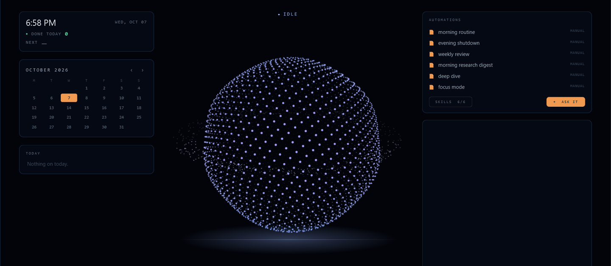
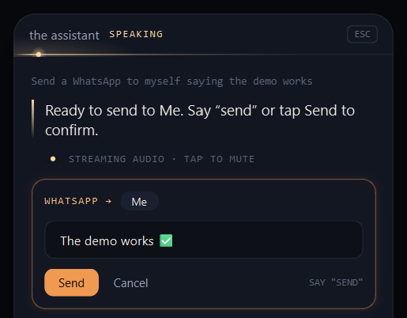
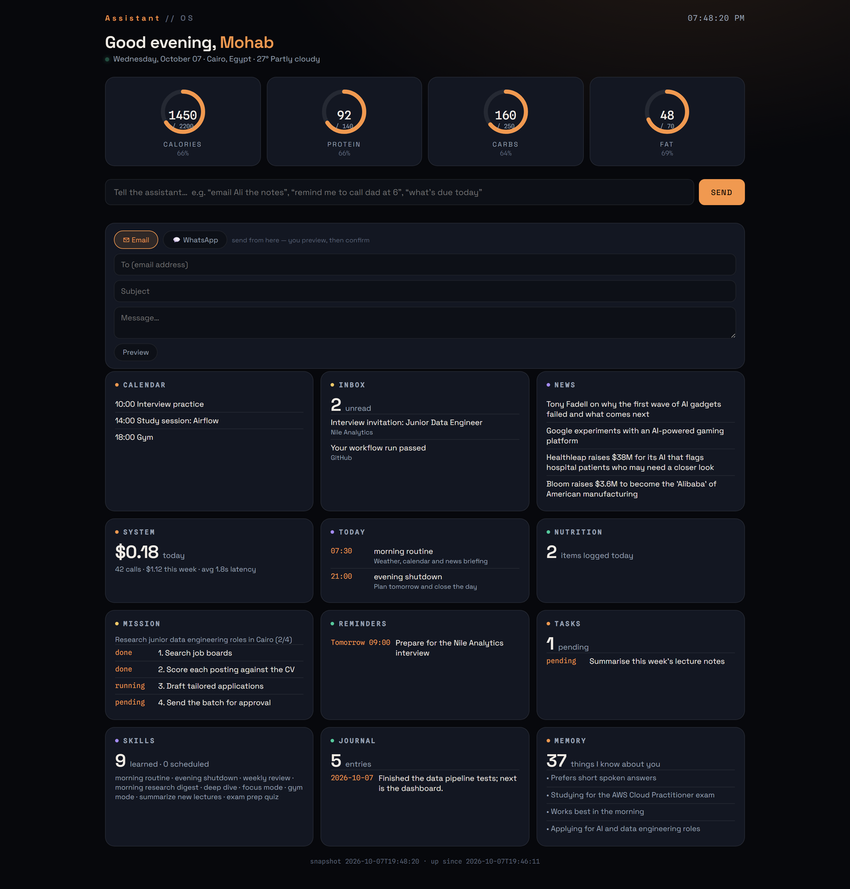
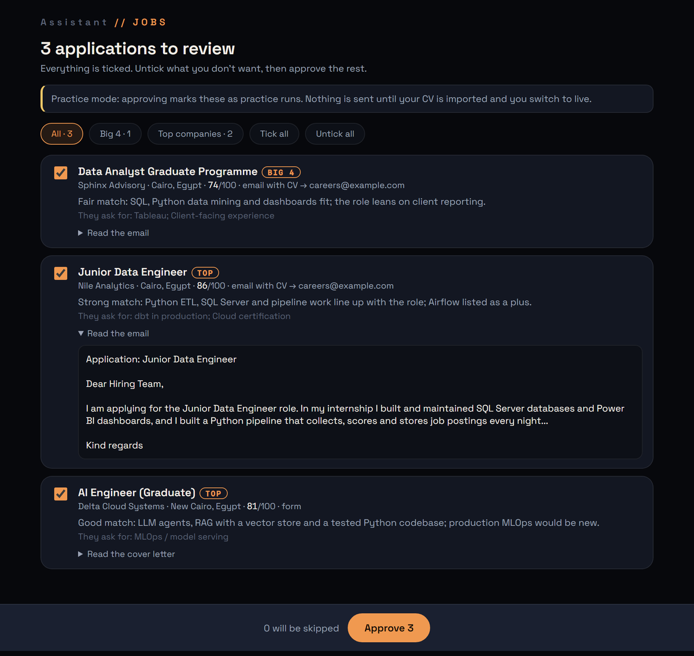
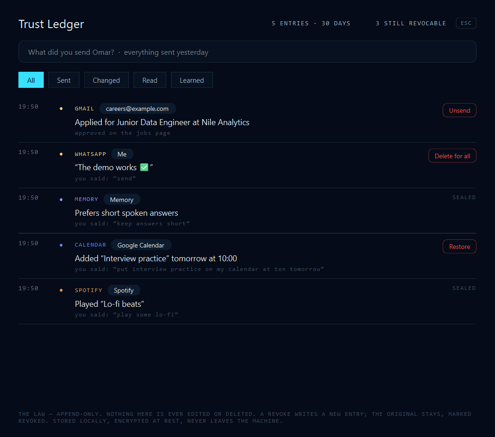
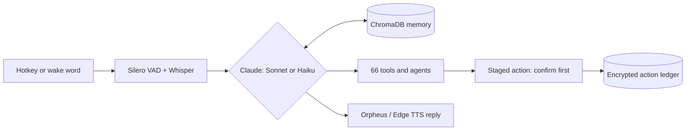

# El Fager: Voice AI Assistant for Windows

A personal voice assistant for Windows 11 that runs the PC for you. It lives in the system tray. You call it with a custom wake phrase or `Ctrl+F12`, speak naturally in English, and it plans the task, uses its tools and answers out loud.

It is built in Python on the Claude API. It has 66 tools, long-term vector memory, its own speech pipeline, and an automated job-search pipeline. **3,000+ pytest tests** gate every change.

> **The source code is private.** This repository shows what El Fager does and how it is built. I am happy to give a live demo or walk through the code in an interview.



---

## What it can do

- **Messages and email:** reads and sends Gmail, WhatsApp and Telegram messages.
- **Music and media:** plays and controls Spotify and YouTube.
- **Files and apps:** finds, opens, moves and converts files and PDFs; launches apps; runs PowerShell.
- **Planning:** Google Calendar, reminders, Todoist, Notion and Obsidian notes.
- **Screen control:** reads the screen with vision and uses the mouse and keyboard to drive apps.
- **Research:** web search, Wikipedia, news and a research agent that writes up findings.
- **Job search:** finds postings, scores each one against the CV, writes a tailored CV and cover letter, and applies only after one-click approval.

## A look inside

*Screenshots use sample data.*

**Confirm before it sends.** Every outgoing message is staged first, showing who it goes to and what it says. It sends only when you say "send" or tap Send.



**Dashboard.** Calendar, inbox, news, a running multi-step mission, reminders, memory, and today's API cost and latency, all in one page served by the app.



**Job-search review.** Each posting gets a fit score out of 100, a reason, the skills it asks for that the CV lacks, and a tailored email or cover letter. Nothing is sent until the batch is approved.



**Trust ledger.** Every action is recorded with the words that caused it. While the service still allows it, an action can be undone (unsend, delete for everyone, restore). The record is append-only and encrypted.



---

## How it works



| Layer | What it uses |
|---|---|
| **Reasoning** | Claude API with tool calling. Each request goes to Sonnet or the faster Haiku depending on how complex it is, and a local Ollama model takes over if the API is unreachable. A router hands specialist work to agents: browser, files, screen, research, health and jobs. |
| **Memory** | Sentence-transformer embeddings (`all-MiniLM-L6-v2`) in a ChromaDB vector store, recalled on every turn. |
| **Speech in** | A custom wake-word model, trained with logistic regression on openWakeWord features and exported to ONNX. Silero VAD detects the end of speech, then Whisper transcribes: Groq's cloud Whisper first, with local faster-whisper as fallback. |
| **Speech out** | Groq Orpheus neural TTS, with Edge TTS as fallback. You can talk over it to interrupt (barge-in). |
| **Trust and safety** | Every action taken on your behalf is written to an append-only ledger, encrypted at rest with Fernet. Nothing is ever edited or deleted, and an undo is a new entry. API keys live in an encrypted vault. |
| **Cost control** | A hard monthly API budget. Every call is metered, and the assistant switches to the local model when the budget is used up. |
| **Interface** | PyQt6 overlay and command center, plus a local HTTP/JSON dashboard. |

### Job-search pipeline

```
find  →  score  →  tailor  →  approve  →  apply  →  track replies
```

Every night it collects postings from the job boards (LinkedIn, Wuzzuf) and from company career sites. It scores each posting against the CV with an LLM and drafts a tailored application for the strong matches. In the morning the batch waits on the dashboard's `/jobs` page, and nothing is sent until it is approved. A practice mode records what *would* have been sent without anything leaving the machine.

### Code layout

```
core/      brain (model routing, tool dispatch), agents, career pipeline,
           speech in/out, barge-in, memory, ledger, dashboard
tools/     66 tools (email, WhatsApp, Spotify, calendar, files, screen, ...)
ui/        PyQt6 overlay, command center and cockpit
tests/     3,000+ pytest tests, run in CI on every push
scripts/   wake-word training and maintenance
```

---

## Tech stack

Python · Claude API (Sonnet, Haiku) · Ollama · Groq Whisper and Orpheus · faster-whisper · Silero VAD · openWakeWord · ONNX · ChromaDB · sentence-transformers · PyQt6 · Fernet encryption · Windows UI Automation · pytest · GitHub Actions

---

© 2026 Mohab Mohamed Fawzy. All rights reserved. The screenshots and text in this repository may not be copied or reused without permission.
